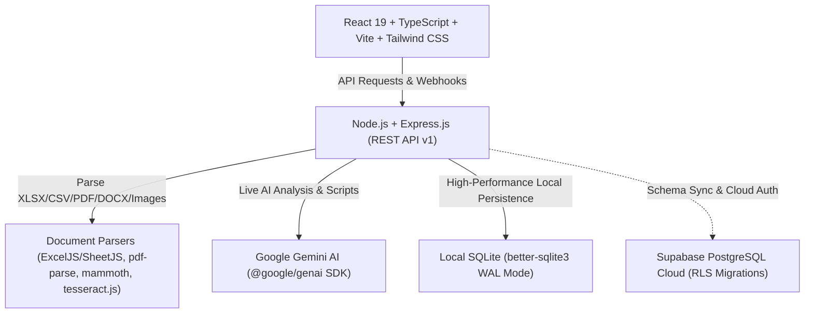

# Quenoxa AI Business Intelligence & Sales Automation Platform

> **Production Full-Stack Application for Quenoxa Global Technologies**  
> Complete document intelligence, automated sales scripts (Thanglish / English / Tamil), WhatsApp outreach, cold email generation, CRM pipeline, and acceptance calibration.

---

## 1. System Architecture



---

## 2. Technology Stack

- **Frontend**: React 19, TypeScript, Vite, Tailwind CSS v4, Lucide Icons, Recharts, jsPDF, SheetJS (`xlsx`)
- **Backend**: Node.js v22, Express.js, TypeScript (`tsx`), Multer, CORS
- **AI Engine**: Official Google Gen AI SDK (`@google/genai`) with configurable models (`gemini-1.5-flash`, `gemini-2.0-flash`, `gemini-1.5-pro`) and intelligent fallback calibration
- **Database**:
  - Local persistent SQLite (`data/quenoxa.db`) in WAL mode with all 22 relational entities
  - Complete Supabase PostgreSQL schema with Row Level Security (RLS) policies in `supabase/migrations/20261020000000_quenoxa_init.sql`
- **Document Processing**:
  - Spreadsheets: SheetJS (`xlsx`) & `exceljs`
  - PDF: `pdf-parse`
  - DOCX: `mammoth`
  - Scanned Documents / Images: `tesseract.js` (OCR)

---

## 3. Application Modules (15 Views)

| Module | Purpose & Core Capabilities |
| :--- | :--- |
| **1. Dashboard** | Executive metrics, Recharts trends, live pipeline values, and **Actual Acceptance Rate** (`Accepted / (Accepted + Rejected) × 100`). |
| **2. Upload Documents** | Drag-and-drop file ingestion (XLSX, CSV, PDF, DOCX, TXT, OCR), sheet selection, auto column mapping, and duplicate/invalid validation. |
| **3. Data Explorer** | Sticky-header table with search, filters (duplicates/missing), multi-record batch select, and 7 direct 1-click action buttons. |
| **4. AI Analysis** | 6-Part business report (Profile, Requirements, Missing Info, Gap Analysis, Solutions, Next Actions) with verified facts vs hypotheses distinction. |
| **5. Service Recommendations** | Needs-to-catalog matching engine, ranked scores, objection preparation, and Acceptance Likelihood calibration. |
| **6. Cold Call Studio** | High-converting calling scripts in **Thanglish** (natural Tamil written in English script), English, or Tamil, across 30s, 1m, and 3m durations, with a 10-objection handling vault. |
| **7. WhatsApp Outreach** | Click-to-chat `https://wa.me/PHONE_NUMBER?text=ENCODED_MESSAGE` generator across 8 templates. Logs action as "WhatsApp opened" (unconfirmed send). |
| **8. Cold Email Studio** | Multi-tone email composer (Professional, Consultative, Urgent, Executive) with encoded `mailto:` triggers and in-app delivery logging. |
| **9. CRM & Leads** | Full lead lifecycle management, interaction counters, deal values, and 12 pipeline stages. |
| **10. Follow-up Tasks** | Due today, upcoming, and overdue callback reminders with AI-suggested personalized touchpoint notes. |
| **11. Sales Pipeline** | Visual horizontal Kanban board with cumulative stage valuations and deal progression controls. |
| **12. Reports & Analytics** | Statistically calibrated win rates, service offering breakdowns, and instant PDF/Excel exports. |
| **13. Service Catalog** | Administrative catalog management for the 12 core Quenoxa service categories. |
| **14. Team Management** | Representative tracking, lead allocations, call quotas, and closed-won win rates. |
| **15. Settings** | Secure server-side Gemini API key storage, Supabase project credentials, OCR toggles, and 1-click sample dataset seeding. |

---

## 4. Setup & Running Locally

### Prerequisites
- Node.js >= 18 (Tested on Node.js v22.23.1)
- npm >= 9

### Quick Start

1. **Install dependencies**:
   ```bash
   # In root directory
   npm install
   cd server && npm install
   cd ../client && npm install
   cd ..
   ```

2. **Start both Backend and Frontend**:
   ```bash
   npm run dev
   ```
   - **Frontend App**: [http://localhost:3000](http://localhost:3000)
   - **Backend API**: [http://localhost:5001/api/v1](http://localhost:5001/api/v1)
   - **API Health Check**: [http://localhost:5001/api/health](http://localhost:5001/api/health)

3. **Explore with Sample Data**:
   - Click the **"Seed Sample Prospects"** button in the top navigation bar, or run:
     ```bash
     curl -X POST http://localhost:5001/api/v1/seed-sample
     ```
   - This seeds real prospect records, call logs, proposals, and pipeline stages so all charts, Kanban boards, and acceptance metrics populate instantly.

---

## 5. Security & Compliance Principles

- **Untrusted Document Boundary**: Uploaded files and spreadsheet cells are strictly treated as untrusted text; embedded prompt injection attacks cannot override system instructions or access controls.
- **Credential Isolation**: The Google Gemini API key and Supabase service keys reside strictly on the Node.js backend.
- **Accurate Outreach Metrics**: Opening WhatsApp Web or generating a mailto link is logged as an opened client trigger; it is never misrepresented as a confirmed delivery without verified webhooks.
- **Data Integrity**: In analytics reports, missing customer fields are highlighted as discovery questions rather than treated as proof of absence.
